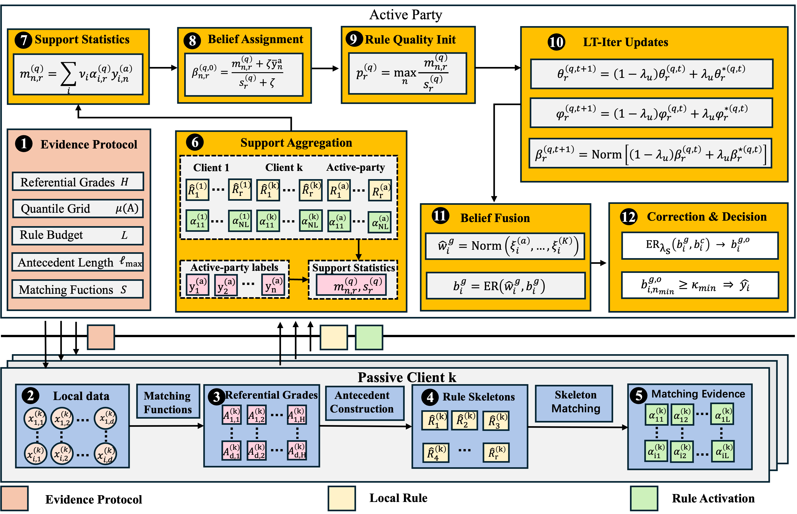

# IBR-VFL

This is the author-maintained reference code repository for **[An Interpretable Vertical Federated Learning Framework Based on Belief Rule Bases for Long-Tailed Classification](https://doi.org/10.1016/j.knosys.2026.117129)**, published in *Knowledge-Based Systems*.

**Ziqian Lin, Longhao Yang, Ying-Ming Wang**  
[Paper](https://doi.org/10.1016/j.knosys.2026.117129) · [Repository](https://github.com/coke2020ice/IBR-VFL)

<p align="center">

</p>

## Brief Introduction

IBR-VFL constructs client-local rule evidence and combines it at the label-holding active party for interpretable long-tailed classification. LT-Iter refines consequent-side parameters; SCER represents cross-source co-matching evidence. Party roles are simulated in one program, not a physically distributed deployment.

## Abstract

Vertical federated learning (VFL) enables collaborative modeling over aligned samples with distributed features, but it usually leaves the evidence chain behind each collaborative decision implicit. Models built on belief rule bases (BRBs) provide an interpretable framework by retaining a traceable rule-evidence path for each prediction. However, conventional BRB learning assumes centralized access to complete features and labels, which conflicts with standard VFL, where passive clients retain raw features locally and labels are held by the active party. To bridge this gap, this paper formulates rule-evidential learning under VFL constraints and proposes Interpretable Belief-Rule-Based Vertical Federated Learning (IBR-VFL) for long-tailed vertical federated classification, \revadd{where tail classes contain substantially fewer samples than head classes.} In IBR-VFL, passive clients construct label-free local rule skeletons and transmit matching-degree summaries, which the active party converts into source-wise belief-rule evidence and fuses through evidential reasoning. Long-tailed iterative refinement improves consequent-side rule parameters, while source-composed evidence rules capture cross-source co-matching patterns to strengthen tail-class evidence. Experiments on four tabular datasets show that IBR-VFL maintains competitive predictive performance among rule-evidence models. Case-level tracing and evidence-masking analyses further demonstrate that, without pooling passive-client raw features, IBR-VFL retains a traceable path from local rule matches and source-wise beliefs to cross-source evidence and final tail-class decisions. The project page is available at https://github.com/coke2020ice/IBR-VFL.

## Dataset

The included long-tail runner supports Default Credit, Adult and Bank Marketing. See [DATASETS.md](DATASETS.md) for acquisition and terms. Raw records are excluded. The publication also includes additional experiments; this release does not claim that the three-dataset runner reproduces every published table.

## Requirements

```bash
python3 -m venv .venv
source .venv/bin/activate
python -m pip install -r requirements.txt
```

Dependencies are listed in `requirements.txt`; they are currently unpinned. A clean-install/full-experiment reproduction has not been validated in this release.

## Main Baselines

The original comparison runners are preserved under `code/scripts/`. Implementations and settings should be read from these scripts; their presence is not a claim of equivalence to each method's official implementation. No copied performance claims are asserted here.

## Training and Evaluation

Check the command interface:

```bash
python train_IBR_VFL.py --help
```

Run the archived three-dataset long-tail protocol:

```bash
bash run_reproduce_long_tail.sh
```

Some comparison runners require external software such as FedTree and optional XGBoost dependencies that are not bundled. Install the upstream components required by the selected methods before running the full comparison. This can download data and take substantial time. Generated outputs go to `results/` or `outputs/` and are ignored by Git. This archived protocol has not been reconciled against every final published result.

## Repository Structure

```text
train_IBR_VFL.py          # root entry point (delegates to original runner)
code/vfl_tuned_dr_mbrb/   # original model implementation
code/scripts/            # original experiment runners
configs/                 # original configuration
figures/Framework.png    # manuscript framework figure
DATASETS.md              # data acquisition instructions
run_reproduce_long_tail.sh
requirements.txt
```

## Citation

```bibtex
@article{lin2026ibrvfl,
  title = {An Interpretable Vertical Federated Learning Framework Based on Belief Rule Bases for Long-Tailed Classification},
  author = {Lin, Ziqian and Yang, Longhao and Wang, Ying-Ming},
  journal = {Knowledge-Based Systems},
  year = {2026},
  pages = {117129},
  doi = {10.1016/j.knosys.2026.117129}
}
```

## Contact

For code questions, please open a GitHub issue. For publication correspondence, use the contact information on the paper.

## Release Notes

This is a source/reference release, not independently certified full-paper reproduction. Historical results and prior Git history remain private. No additional open-source license grant is assigned; licensing review remains pending.
